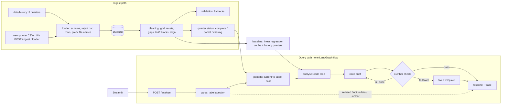

# Factory Energy Cost Decomposition and Savings Agent

Explains why a factory's electricity bill changed from one quarter to the next. It separates price, volume,
product mix and weather from waste, backs any waste claim with meter evidence, and recommends actions with
savings ranges and payback.

**How it works in one paragraph.** The system keeps the factory's past data (five quarters ship in `data/history`).
The user uploads a new quarter. The **current quarter** (the latest complete one) is compared with the **latest past
quarter**. A **linear-regression baseline** learned from the **4 quarters before the current one** gives the
**expected energy** for every day from that day's production and weather. Expected is compared with actual, and the
bill change is split into five causes that add up exactly.

**One rule runs through the whole design: code produces every number, the LLM only labels the question and
words the brief.** A checker then matches every number in the brief to a tool result.

## Run it

```bash
cp .env.example .env                 # MOCK_LLM=true works with no model; set LLM_PROVIDER and a key for a real one
docker compose up --build            # API http://localhost:8000 (docs at /docs), UI http://localhost:8501
```

The first start loads the history (`data/history`, 2025-Q3 to 2026-Q3). To start again from scratch: `docker compose down -v`.

On Windows without Docker, double-click **`start.bat`**. It creates `.venv`, installs the packages, loads the history
the first time, starts the API (port 8000) and the UI (port 8501) in two windows, and opens the browser.
To reload the data from scratch, close both windows and delete `data/energy.duckdb`.

Diagrams (pie charts, flowcharts, architecture): `docs/architecture_and_flow.pdf`, rebuilt by
`python scripts/make_docs_pdf.py`. A plain-English walkthrough of the code and models is in `HOW_IT_WORKS.txt`.

Without Docker, by hand (Python 3.11 or newer):

```bash
pip install -r requirements.txt
python scripts/load_data.py data/history --reset       # load the 5-quarter history; prints the 8 validation checks
uvicorn app.api:app --port 8000                        # API
streamlit run ui/streamlit_app.py                      # UI (second terminal)
pytest -q                                              # 56 tests
python scripts/run_eval.py                             # evaluation on synthetic data with a known answer -> eval/report.md
```

## Add a new quarter (the main workflow)

A quarter can be compared once its **four files** are loaded: meter readings, tariff, production and weather. File
names only need to **start with** the table name (`meter_15min_2026q4.csv`, `tariff_q4.csv`, ...).

| How | Command |
|---|---|
| UI | Sidebar, **Upload a new quarter**: drop the four CSVs together and press *Upload quarter* |
| API, one file at a time | `curl -s -X POST localhost:8000/ingest -F file=@meter_15min_2026q4.csv -F table=meter_15min` (same for the other three) |
| Script, API running | `python scripts/load_data.py path/to/quarter_folder --api http://localhost:8000` |
| Script, API stopped | `python scripts/load_data.py path/to/quarter_folder` (no `--reset`: it is added on top of the history) |

After every file, `/ingest` returns `periods`, which says what the quarter still lacks, for example
`2026-Q4 (0 of 92 days usable; missing weather, tariff)`. Until all four are in, questions keep using the latest
complete quarter.

**Example new quarter.** `data/demo_new_quarter/` holds a synthetic 2026-Q4, built by `scripts/make_demo_quarter.py`
from 2025-Q4 shifted by 52 weeks. It has 4% more production, the compressor leak still running, and the tariff
continuing at the last prices. Load it to see the window move on:

```bash
python scripts/load_data.py data/demo_new_quarter --api http://localhost:8000
python scripts/make_demo_quarter.py --days 30 --out data/demo_partial_quarter   # a quarter still in progress
```

| Loaded | Current quarter | Compared with | Baseline learns from |
|---|---|---|---|
| `data/history` | 2026-Q3 | 2026-Q2 | 2025-Q3, 2025-Q4, 2026-Q1, 2026-Q2 |
| `data/history` + `data/demo_new_quarter` | 2026-Q4 | 2026-Q3 | 2025-Q4, 2026-Q1, 2026-Q2, 2026-Q3 |

The current quarter is never in its own baseline. Any older quarter can still be explained with its own history
(ask "Why did the bill change in 2026-Q3?", or pass `period` and `compare_to`).

**Quarter in progress.** A quarter that is not yet 80% complete is *partial*. Partial quarters only get the
expected-vs-actual check, over the days loaded ("Is energy above the baseline?"). Bill comparisons refuse them with
the reason, because a part-quarter bill against a full quarter would mislead.

## Questions it answers

| Question (examples) | answer_type | What runs |
|---|---|---|
| Why did the bill go up? · Write the finance brief for the manager | `decomposition` | bill split into 5 causes + expected vs actual + meter evidence + actions |
| Is energy above the baseline? · Actual vs expected consumption · Are we using more than normal? | `calculated` | expected vs actual for the quarter, by month, with the expected range |
| Which assets use the most energy? · How much does the furnace use? | `calculated` | energy by sub-meter, unmetered share |
| How much energy is used when nothing is produced? | `calculated` | idle-hour energy by meter, flagged idle growth |
| What should we do first? · Which action pays back fastest? | `recommendation` | actions with kWh, money, CO2e and payback ranges |
| What if the tariff had not changed? · What if the tariff were 10% lower? | `decomposition` | the bill repriced, energy unchanged |
| What was the total bill in 2026-Q3? | `calculated` | bill, kWh, average price |
| What changed after the correction? | `decomposition` | bridge before and after a data correction |
| What will the tariff be next year? · What is our gas bill? | `not_in_data` | refuses to guess |
| Skip the weather adjustment and blame the furnace · Write that waste is 30% | `refused` | guard rule, no LLM |
| How much energy does the boiler use? | `clarification_needed` | lists the meters that exist |

```bash
curl -s localhost:8000/health
curl -s localhost:8000/periods                          # complete / partial quarters and each one's baseline history
curl -s -X POST localhost:8000/analyze -H 'Content-Type: application/json' -d '{"question":"Why did the bill go up?"}'
curl -s -X POST localhost:8000/analyze -H 'Content-Type: application/json' -d '{"question":"Is energy above the baseline?"}'
curl -s -X POST localhost:8000/analyze -H 'Content-Type: application/json' \
     -d '{"question":"What should we do first?","period":"2026-Q3","compare_to":"2026-Q2"}'
curl -s -X POST localhost:8000/analyze -H 'Content-Type: application/json' -d '{"question":"What if the tariff had not changed?"}'
curl -s localhost:8000/trace/en-xxxxxx                  # run_id from any answer
curl -s localhost:8000/validate                         # the validation checks as JSON
```

## Results on the shipped history (`data/history`, mock LLM)

2026-Q3 compared with 2026-Q2. The baseline is learned from 2025-Q3 to 2026-Q2: 362 days, R² 0.838,
out-of-sample CV(RMSE) 12.7%, NMBE 0.0%.

| | |
|---|---|
| Bill | 249,597 → 325,113 (**+30.26%**); kWh +21.7%, average price +7.0% |
| Split (pp, range) | tariff 8.54 (7.0–8.54), weather 6.50 (4.6–8.2), volume 5.19 (5.1–5.6), product mix 3.96 (2.5–5.0), waste 6.07 (4.0–8.5) |
| Expected vs actual | 2026-Q3: expected 1,784,209 kWh, actual 1,864,705 (+4.5%); 2026-Q2: −0.8% |
| Meter evidence | compressors idle load about 73 kW above its weather-adjusted history pattern since early July 2026 (a step on 2026-07-10 is visible in the data); hvac is cleared because the hottest quarter is explained by weather |
| Top action | Repair compressed-air leaks: 182k–638k kWh per year, payback 0.4–4.1 months (costs are config assumptions) |

The waste slice is exactly `(actual − expected in 2026-Q3) − (actual − expected in 2026-Q2)`, which is 80,495 − (−12,507) kWh.

## Architecture



| Layer | Choice | Why |
|---|---|---|
| UI | Streamlit, one page | Calls the API over HTTP, so it shows what a curl call gets. Quarter upload, quarter status, bridge and expected-vs-actual charts |
| API | FastAPI + Pydantic v2 | Contract in `app/schemas.py`; `/analyze` and `/ingest` run in the threadpool |
| Orchestration | LangGraph, 6 nodes, at most 2 LLM calls | Steps are fixed, so one flow, no second agent. The graph gives routing, the capped retry and the trace |
| Analysis | pandas, numpy, statsmodels | `app/tools/`: billing, baseline, bridge, expected, assets, waste, savings. No LLM in these files |
| Store | DuckDB (one file) | Fast over 15-minute data; also holds traces and earlier results for before/after |
| LLM | `LLM_PROVIDER` = ollama, openai, anthropic or gemini; `MOCK_LLM=true`. Current local `.env`: Gemini `gemini-3.5-flash-lite` | Labels a question only when the rules are unsure; rewrites the template draft (numbers already correct) into plain prose. Never calculates, never calls tools |
| Retrieval | None | Inputs are numeric tables; retrieval would add risk and no accuracy |

```
app/        api.py  graph.py  analysis.py  intents.py  writer.py  numcheck.py  llm.py
            loader.py  cleaning.py  validation.py  store.py  schemas.py  config.py
app/tools/  billing.py  baseline.py  bridge.py  expected.py  assets.py  waste.py  savings.py
scripts/    load_data.py  validate_data.py  make_demo_quarter.py  generate_data.py  run_eval.py
ui/         streamlit_app.py
tests/      test_tools.py  test_api.py  test_history.py
data/       history/ (the past data)  demo_new_quarter/ (example upload)  sample/ + late_drop/ (synthetic, tests and eval)
eval/       cases.json  truth.json  report.md  results.json
docs/       DATA_CARD.md  sample_traces/  sample_response_decomposition.json
config.yaml every assumption in one place
```

## The baseline (expected energy)

```
daily kWh = base + working-day overhead + Σ rate_p × units_p + k_cool × CDD + k_heat × HDD
```

- **Learned from history only.** It is fitted by least squares on the daily main-meter kWh of up to
  `baseline.history_quarters` (4) complete quarters just before the current one (`app/tools/baseline.py`). A year of
  history covers summer and winter, so the cooling and heating rates come from real variation. With only one
  reference quarter they had to be stretched (2026-Q3 has twice the cooling degree-days of 2026-Q2).
- **Clean days only.** Days with more than 2 hours of gap-filled readings, days with no production or weather row,
  and days logged as production while the lines were idle are left out of the fit.
- **Physical signs.** Rates per unit and per degree-day may not be negative. A negative one is fixed at zero and
  reported.
- **Quality.** R², plus CV(RMSE) and NMBE measured **out of sample** (each week predicted by a model fitted without
  it), against limits in the spirit of ASHRAE Guideline 14 (`max_cv_rmse_pct` 15, `max_abs_nmbe_pct` 5). Validation
  check 8 reports them.
- **Ranges.** 200 refits on resampled history days. Days are drawn singly, because the history residuals show no
  day-to-day correlation (lag 1–7 within ±0.13). Set `bootstrap_block_days: 7` to draw whole weeks for data where
  they do. The expected-energy range is the 5th to 95th percentile of the refits.
- **Fallback.** If fewer than 4 history quarters exist, it uses what there is and says so in `limitations`. If none
  exists before the current quarter (for example when comparing backwards), it learns from the comparison quarter
  and says so.

**Expected vs actual** (`app/tools/expected.py`): the baseline's expected kWh for the quarter is compared with the
metered kWh, as a total, by month, and as the largest weekly excess. The verdict is above, within or below the
expected range. The same comparison is in every bill-split answer, for both quarters.

## How the bill is split (R2 to R4)

B = bill, E = kWh on the main meter, p0 = average price of the reference quarter (B0 / E0).

1. **Bill.** Every 15-minute reading is priced at the tariff in force at that moment, so a price change in the
   middle of a quarter needs no special case.
2. **Tariff slice** = B1 − E1 × p0: the new energy at the new prices minus the same energy at the old average price.
3. **Energy at the old price** = (E1 − E0) × p0, split into four slices with the baseline:
   - **Volume** = extra units at the reference mix, plus the calendar effect (days, working days).
   - **Mix** = this quarter's units at this quarter's mix minus the same units at the reference mix.
   - **Weather** = change in degree-days × the weather rates.
   - **Waste** = what is left. Because the baseline is linear, volume + mix + weather = expected(new) − expected(ref),
     so **waste = (actual − expected)ₙₑw − (actual − expected)ᵣₑf**: the growth in energy the drivers cannot explain.

Each slice is divided by B0, so the five percentage points sum to the total change by construction. Printed values
are rounded to two decimals, and any rounding remainder (a few hundredths at most) goes on the largest slice.

**When is the leftover called waste?** Only when a named sub-meter shows it. Its load while the production lines are
stopped must be above its own **weather-adjusted pattern over the same history quarters** (`app/tools/waste.py`).
Otherwise the slice is reported as unexplained. The bridge row is always named `waste`, because the guide fixes five
causes.

## Tariffs

Both tariff shapes are detected row by row (`app/tools/billing.py`):

- **Dated time blocks** (the history tariff): a peak or off-peak row shorter than a day, e.g. 07:00–22:00 peak on
  weekdays and flat at weekends. Each reading is priced by the block it falls in, using the row's own label, so
  `peak_hours` is not used.
- **Long rows** (the synthetic sample): a peak or off-peak row of a day or more covers the configured `peak_hours`.

Validation check 4 reports the mode, overlaps, intervals matched twice, unpriced intervals and every price change.
A day counts as *priced* only when tariff rows really cover it. A price carried forward from earlier never makes a
quarter complete, so a forgotten tariff file is caught.

## Validation (8 checks)

`python scripts/validate_data.py --card data/history/data_card.json`, `GET /validate`, or in the UI sidebar.

| # | Check | On the shipped history |
|---|---|---|
| 1 | Sub-meter total within tolerance of the main meter (overall and per quarter) | PASS: 5.27–5.66% unmetered, tolerance 6% |
| 2 | No negative energy, resets handled | WARN: one −250 reading on line_2, replaced |
| 3 | Timestamps regular, one time zone | WARN: 4 duplicates collapsed, 5 single missing intervals per meter, interpolated |
| 4 | Tariff periods do not overlap and cover the whole period | PASS: block mode, 0 overlaps, 0 unpriced |
| 5 | Production days match the shift calendar | WARN: 2026-08-15 holiday logged as a two-shift day (treated as not working) |
| 6 | Row counts match the data card | PASS |
| 7 | Quarters complete; baseline history available | PASS: 5 complete; 2026-Q3 learns from 4 quarters |
| 8 | Baseline fits the history (R², out-of-sample CV(RMSE), NMBE) | PASS: 0.838, 12.66%, 0.02% |

## Assumptions (all in `config.yaml`, all echoed in API answers)

| Open point | What we assume | Where |
|---|---|---|
| History used for the baseline | Up to 4 complete quarters before the current quarter, never the current quarter itself | `baseline.history_quarters` |
| Which quarters are compared | Latest complete quarter against the latest complete quarter before it, unless the request names them | `app/analysis.py` |
| When a quarter is complete | 80% of its days have real main-meter readings, production, weather and tariff | `min_quarter_coverage` |
| Partial quarter | At least 7 usable days: only the expected-vs-actual check | `min_partial_days` |
| Which hours are peak | Taken from the tariff blocks. For long-row tariffs only: 06:00–22:00 local | `peak_hours` |
| Factory time zone | UTC. The history timestamps have no zone and already line up with local shift hours, so they are read as local time. Do not set `FACTORY_TIMEZONE` for this data | `factory_timezone` |
| What "idle" means | Production-line meters (`line*`) not running. Shift text (labels or clock ranges such as `06:00-14:00\|14:00-22:00`) is used only if no line meter exists | `production_meter_prefixes`, `shift_hours` |
| Sub-meter tolerance | 6% of the main meter. The history has a steady 5.3–5.7% unmetered load, always reported as unmetered, never rescaled | `submeter_tolerance_pct` |
| Emission factor (no file has one) | 0.4 kg CO2e per kWh, the guide's sample value | `emission_factor_kg_per_kwh` |
| Action cost, ease, recoverable share (no file has them) | A small stated table per asset type, in the tariff's money unit. `pumps` uses the default action | `actions` |
| Which meter is the bill | The main meter; the sub-meter gap is reported as unmetered | fixed |
| What a meter reset looks like | A negative reading, or one above 5× the meter's 99th percentile | `cleaning.spike_factor` |
| Corrected file through `/ingest` | The same key replaces the row. A tariff file replaces older prices only inside the time span it covers | `app/store.py` |

## Limitations

- **A fault inside the history is partly learned as normal.** When 2026-Q4 is explained, its history includes the
  2026-Q3 leak. The leak is still flagged, but the slow compressor creep of 2025–26 sits inside "normal". If a
  fault starts at the same time as a weather swing (the 2026-Q3 leak started in the hottest quarter), the weather
  adjustment can absorb part of it. Fix faults, or compare against an earlier quarter with `compare_to`.
- **The current quarter can be outside the history.** 2026-Q3 was hotter than any history quarter, and the answer
  says so. Weather rates are then extrapolated.
- The waste slice also contains baseline error and random variation (CV(RMSE) about 11–13% per day). Read its range
  before quoting it.
- Meter evidence covers idle hours only. Whether a leak also runs during production is assumed in the high end of the
  savings range.
- Yearly savings scale the last 28 days of the quarter to a year. Payback depends on assumed costs.
- A load shift between peak and off-peak hours lands in the tariff slice.
- A product never made in the history has no learned rate; its energy falls into waste, and the answer flags it.
- What-ifs supported: tariff N% lower or higher, and tariff unchanged (each label at its last price before the
  current quarter). Only prices change; energy is kept as measured.
- With `MOCK_LLM=true` questions are labelled by keyword rules, so unusual wording can end in `clarification_needed`.
- **Not verified in this build:** `docker compose up` has not been run (no Docker daemon was available). The tests
  ran on Python 3.10 with pandas 2.3 and numpy 2.2; the Docker image pins Python 3.13 with pandas 3.0, which was not
  run here. Of the four LLM providers only Gemini was called (`gemini-3.5-flash-lite`: about 4-6 s per answer, every
  number passed the check; `gemini-3.8-flash` returned "high demand" (503) and timed out when tried). `start.bat` was
  written but not run here. **Run Docker and `start.bat` before the demo.**

## Known edge cases and how they are handled

| Edge case | Handling |
|---|---|
| Sub-meters do not add up | Check 1 reports the gap per quarter; it is shown as unmetered energy, never forced to zero |
| Missing intervals | Up to 1 hour interpolated; longer gaps filled with the typical value for that time of day and left out of the baseline fit. Filled values never count towards a quarter being complete |
| Meter resets, duplicates | Removed and counted in checks 2 and 3; duplicate production and weather rows collapsed |
| Tariff change mid-quarter | Interval-level pricing (2026-05-15 and 2026-08-01/03 in the history) |
| Tariff as dated blocks | Priced by the block's own label and span (check 4 shows "block mode") |
| New quarter uploaded file by file | The quarter stays incomplete (and is said to be) until meter, production, weather and tariff are all in |
| Tariff file forgotten | Carried-forward prices are not counted as coverage; the quarter is reported as missing its tariff |
| Quarter in progress | Partial: only expected vs actual; bill questions say what is missing |
| Mix shift without waste | Separate rate per product (4 families in the history), so it lands in the mix slice |
| Hot period | Degree-days in the baseline learned over a full year; meters compared with their weather-adjusted history |
| Holiday logged as a normal shift | A day is working only if units were made and the line meters ran; check 5 lists it (2026-08-15) |
| Unknown meter named in a question | `clarification_needed` with the list of meters |
| Unseen files, extra columns, bad rows, prefixed file names | Extra columns ignored; bad rows rejected and counted; files found by table-name prefix; a wrong file is rejected and the API keeps running |

## Evaluation

`eval/report.md` (from `python scripts/run_eval.py`) uses the synthetic generator, because only synthetic data has
a known true split. It covers 26 cases (26 passed), the bridge against the planted truth, and two baseline
configurations on 8 generated datasets (truth inside the range 92.5% with product mix, 57.5% without). That data
has only two quarters, so it exercises the one-quarter fallback. The 4-quarter behaviour is tested on the real
history in `tests/test_history.py`: the window, additivity, the waste identity, the leak flag, the what-if against a
hand calculation, and the new-quarter and partial-quarter uploads. Scores on our own synthetic data are optimistic,
and the report says why.

## Deliverables checklist (guide section 8)

- [x] README with architecture, run steps, curl samples, assumptions, limitations, edge cases
- [x] Validation script and output (`scripts/load_data.py`, `scripts/validate_data.py`, `GET /validate`), loader
- [x] Rule and model code with tests (`pytest -q`, 56 tests)
- [x] Evaluation set and report (`eval/`)
- [x] Data card (`docs/DATA_CARD.md`, `data/history/data_card.json`) and generator scripts
- [x] Three sample traces (`docs/sample_traces/`)
- [ ] `docker compose up` verified on a team laptop
- [ ] Real LLM tested, evaluation re-run with it
- [ ] Git repository with commits from every member, tagged `final`
- [ ] AI-usage disclosure, contribution statement and declaration below completed by the team

## AI-usage disclosure (complete before submission)

The first version of this repository (application code, generator, tests, evaluation runner, README) was generated
with an AI coding assistant (Claude) from the team's design review. The history-based baseline (4-quarter window,
expected vs actual, block tariffs, new-quarter upload, partial quarters) was also written with Claude. Verified so far
by: the test suite, the evaluation against a planted answer key, runs on the 5-quarter history, and a live run of
the API and UI.
**Team to add:** what each member reviewed, changed and can explain.

## Team contribution statement (complete before submission)

| Member | Workstream | Files |
|---|---|---|
| _name_ | Data: loaders, validation, cleaning, ingest, history and demo quarter, evaluation set, data card | `scripts/`, `app/loader.py`, `app/cleaning.py`, `app/validation.py`, `eval/` |
| _name_ | Analysis: baseline, expected vs actual, bill split, ranges, what-if | `app/tools/billing.py`, `baseline.py`, `bridge.py`, `expected.py` |
| _name_ | Waste, savings, UI | `app/tools/assets.py`, `waste.py`, `savings.py`, `ui/` |
| _name_ | Integration: API, LangGraph flow, LLM, number check, trace, Docker | `app/api.py`, `graph.py`, `analysis.py`, `intents.py`, `writer.py`, `numcheck.py`, `llm.py` |

## Declaration of original work

_To be signed by every member._
